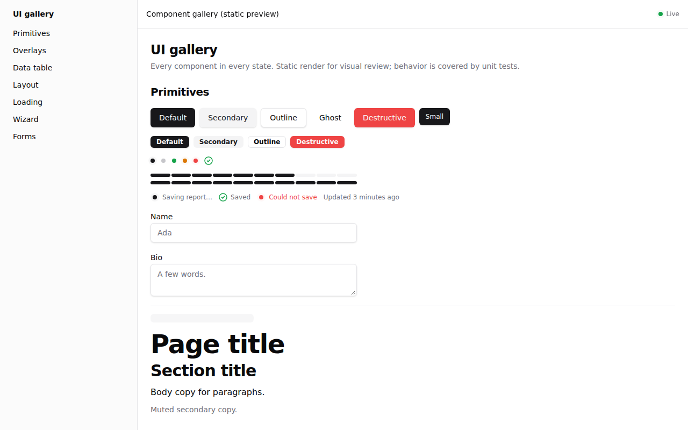

# zedkit

[](https://github.com/zedtech-fr/zedkit/actions/workflows/ci.yml)
[](LICENSE)
[](https://zedkit.app)

Open-source building blocks for modern apps: small, dependency-light TypeScript
packages. MIT licensed; see [LICENSE](LICENSE).

Use **npm packages** (`pnpm add @zedtech/…`) or **copy UI source** via the shadcn
registry where published — [install or copy on the docs site](https://zedkit.app/docs/getting-started#install-or-copy).

<picture>
  <source media="(prefers-color-scheme: dark)" srcset="docs/ui-proof/readme-gallery-dark.png">
  
</picture>

```sh
pnpm add @zedtech/zedkit-ui          # React UI components (Tailwind v4)
pnpm add -D @zedtech/zedkit-ai       # one agent setup for Cursor, Claude, Codex…
```

Docs with live examples: [zedkit.app](https://zedkit.app). Full catalog by need
below; five-minute start in [5-minute quickstart](#5-minute-quickstart).

## Packages

All packages are public on npm. Maturity is the least mature catalog
need per package (criteria: [docs/catalog/README.md](docs/catalog/README.md)).

<!-- packages-table: generated by `pnpm catalog:build` — do not edit -->

| Package | Version | Maturity |
|---|---|---|
| [`@zedtech/zedkit-ai`](packages/ai/README.md) ([npm](https://www.npmjs.com/package/@zedtech/zedkit-ai)) | 0.10.0 | beta |
| [`@zedtech/zedkit-core`](packages/core/README.md) ([npm](https://www.npmjs.com/package/@zedtech/zedkit-core)) | 0.2.2 | beta |
| [`@zedtech/zedkit-devtools`](packages/devtools/README.md) ([npm](https://www.npmjs.com/package/@zedtech/zedkit-devtools)) | 0.2.11 | alpha |
| [`@zedtech/zedkit-flags`](packages/flags/README.md) ([npm](https://www.npmjs.com/package/@zedtech/zedkit-flags)) | 0.2.3 | alpha |
| [`@zedtech/zedkit-i18n`](packages/i18n/README.md) ([npm](https://www.npmjs.com/package/@zedtech/zedkit-i18n)) | 0.2.1 | alpha |
| [`@zedtech/zedkit-nest`](packages/nest/README.md) ([npm](https://www.npmjs.com/package/@zedtech/zedkit-nest)) | 0.1.6 | beta |
| [`@zedtech/zedkit-observability`](packages/observability/README.md) ([npm](https://www.npmjs.com/package/@zedtech/zedkit-observability)) | 0.2.11 | alpha |
| [`@zedtech/zedkit-payload-seo`](packages/payload-seo/README.md) ([npm](https://www.npmjs.com/package/@zedtech/zedkit-payload-seo)) | 0.2.1 | beta |
| [`@zedtech/zedkit-quality`](packages/quality/README.md) ([npm](https://www.npmjs.com/package/@zedtech/zedkit-quality)) | 0.6.1 | beta |
| [`@zedtech/zedkit-seo`](packages/seo/README.md) ([npm](https://www.npmjs.com/package/@zedtech/zedkit-seo)) | 0.1.6 | beta |
| [`@zedtech/zedkit-server`](packages/server/README.md) ([npm](https://www.npmjs.com/package/@zedtech/zedkit-server)) | 0.3.2 | beta |
| [`@zedtech/zedkit-storage`](packages/storage/README.md) ([npm](https://www.npmjs.com/package/@zedtech/zedkit-storage)) | 0.2.1 | alpha |
| [`@zedtech/zedkit-ui`](packages/ui/README.md) ([npm](https://www.npmjs.com/package/@zedtech/zedkit-ui)) | 0.9.4 | alpha |

<!-- /packages-table -->

A package exists only when real, used code backs it — no placeholders.
Each package README records its origin ("original work by the same
author") and what it deliberately leaves out.

## Looking for something?

"I want X, what do you have to do it?" — search the
[catalog index](docs/catalog/README.md) by need (machine-readable:
[docs/catalog/catalog.json](docs/catalog/catalog.json)). Golden rule
(advice): reach every third-party library through a thin wrapper that
re-exports it, instead of importing it directly all over the code — see
[docs/golden-rule.md](docs/golden-rule.md).

Consumer projects: paste this into your agent instructions (canonical text:
`.agents/skills/use-zedkit/SKILL.md` — keep in sync):

<!-- use-zedkit-snippet: must match .agents/skills/use-zedkit/SKILL.md core rule -->

```md
Before writing any helper, check zedkit first, then npm, and wrap what
you adopt: search the zedkit catalog by need and import from zedkit if it
exists; otherwise adopt a mature npm package behind a thin wrapper;
otherwise propose adding it to zedkit with its domain.
```

## 5-minute quickstart

Prerequisites: Node ≥ 22 and pnpm 9. In your own repo:

```sh
pnpm add -D @zedtech/zedkit-ai
npx zedkit-ai init . --provider cursor   # cursor, claude, codex, muse, all
# then ask your agent: "run the setup-ai skill"
npx zedkit-ai validate                   # must print: ok
```

Details: [packages/ai/README.md](packages/ai/README.md). Every package
installs the same way (`pnpm add @zedtech/zedkit-<name>`).

## Tooling

- pnpm workspaces with a pinned `packageManager` and a shared `catalog`
- Turbo pipelines: `typecheck`, `lint`, `build`, `test`
- TypeScript strict, ESM + types, vitest, ESLint (raw `try`/`catch` is banned;
  use `tryCatch` from `@zedtech/zedkit-core`)
- Changesets for versioning; the release workflow publishes public
  packages to npm on every Version PR merge
- Docs site: `pnpm dev` rebuilds the catalog, then serves `apps/docs` with
  hot reload at <http://localhost:3100> (docs at `/docs`)

```sh
pnpm install
pnpm dev                                     # docs site, http://localhost:3100
pnpm typecheck && pnpm lint && pnpm build && pnpm test
```

## Public repo rules

- No secrets, no customer data, no internal URLs.
- No private names, endpoints, or domain terms from other projects.
- Third-party material (e.g. vendored skills) requires its licence file and a
  row in `packages/ai/kit/THIRD_PARTY_NOTICES.md`.
