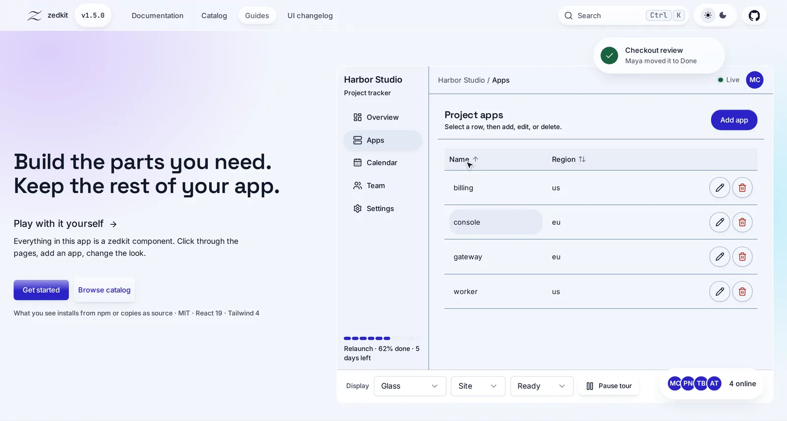
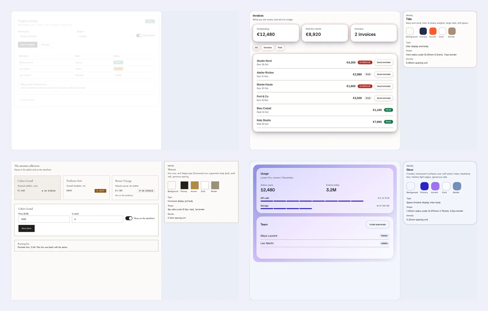

<div align="center">

<picture>
  <source media="(prefers-color-scheme: dark)" srcset=".github/assets/readme/hero-dark.webp">
  
</picture>

# zedkit

### Why rebuild everything, or settle for what exists, when you can start from a top-notch setup?

A UI/AI kit: a polished React UI kit with real identities, and a top-notch AI setup<br>
one prompt away, with the server, SEO and quality packages behind them. Open source, MIT.

[](https://github.com/zedtech-fr/zedkit/actions/workflows/ci.yml?query=branch%3Amain)
[](https://www.npmjs.com/package/@zedtech/zedkit-ui)
[](LICENSE)

**[Docs](https://zedkit.app/docs)** · **[Live demo](https://zedkit.app)** · **[Catalog](docs/catalog/README.md)** · **[AI setup](https://zedkit.app/docs/ai/setup)**

</div>

---

## What you get

**🎨 A UI kit with taste built in** — React 19 + Tailwind 4 components driven by
tokens. Pick an *identity* (type, shape, density, color together) and the same
components read as a newsroom, an invoicing tool, a boutique or a SaaS app.
Install from npm or copy the source through the shadcn registry.

**🤖 A top-notch AI setup in one prompt** — paste one message in Cursor and the
agent installs `zedkit-ai`, interviews you about the repo, and writes rules that
match it. Cursor, Claude Code, Codex and friends share one set of skills,
subagents, review and definition-of-done checks, validated in CI.
([Prompt and file tree](https://zedkit.app/#ai-setup).)

**🧱 The boring parts, done right** — SEO metadata, server helpers, storage,
flags, i18n, observability: small, typed, dependency-light packages.

**✅ Built to last** — strict TypeScript, API reports, changesets and tests on
every package. No placeholders: a package exists only when real code backs it.

<picture>
  <source media="(prefers-color-scheme: dark)" srcset=".github/assets/readme/identities-dark.webp">
  
</picture>

<p align="center"><sub>Same components, four identities. <a href="https://zedkit.app">Try them live →</a></sub></p>

## Start in 60 seconds

**UI** (Node ≥ 22):

```sh
pnpm add @zedtech/zedkit-ui @fontsource-variable/inter @fontsource-variable/space-grotesk
```

```tsx
import { Button } from "@zedtech/zedkit-ui";

export default () => <Button>Ship it</Button>;
```

Pick a look, then fonts (so the finished app matches the site):

```tsx
// src/app/fonts.ts
import "@fontsource-variable/inter";
import "@fontsource-variable/space-grotesk";
```

```tsx
// src/app/layout.tsx
import "./fonts";

export default function RootLayout({ children }: { children: React.ReactNode }) {
  return (
    <html lang="en" data-identity="glass">
      <body>{children}</body>
    </html>
  );
}
```

Styles and setup: [getting started](https://zedkit.app/docs/getting-started#install-or-copy).

**AI setup** — paste this into your agent:

```text
Set up zedkit AI on this repo following https://zedkit.app/ai/setup.md
```

Or by hand:

```sh
pnpm add -D @zedtech/zedkit-ai
npx @zedtech/zedkit-ai setup --provider cursor
npx @zedtech/zedkit-ai validate                   # success: exit 0; final line starts with ok (long scope line)
```

## Highlights

| | Package | npm |
|---|---|---|
| 🎨 | [`@zedtech/zedkit-ui`](packages/ui/README.md) | [](https://www.npmjs.com/package/@zedtech/zedkit-ui) |
| 🤖 | [`@zedtech/zedkit-ai`](packages/ai/README.md) | [](https://www.npmjs.com/package/@zedtech/zedkit-ai) |
| 🔎 | [`@zedtech/zedkit-seo`](packages/seo/README.md) | [](https://www.npmjs.com/package/@zedtech/zedkit-seo) |
| 🧱 | [`@zedtech/zedkit-server`](packages/server/README.md) | [](https://www.npmjs.com/package/@zedtech/zedkit-server) |
| ⚙️ | [`@zedtech/zedkit-core`](packages/core/README.md) | [](https://www.npmjs.com/package/@zedtech/zedkit-core) |

<details>
<summary><b>All packages</b> (version and maturity)</summary>

Maturity criteria: [docs/catalog/README.md](docs/catalog/README.md).

<!-- packages-table: generated by `pnpm catalog:build` — do not edit -->

| Package | Version | Maturity |
|---|---|---|
| [`@zedtech/zedkit-ai`](packages/ai/README.md) ([npm](https://www.npmjs.com/package/@zedtech/zedkit-ai)) | 1.1.2 | beta |
| [`@zedtech/zedkit-brand`](packages/brand/README.md) ([npm](https://www.npmjs.com/package/@zedtech/zedkit-brand)) | 0.1.1 | alpha |
| [`@zedtech/zedkit-core`](packages/core/README.md) ([npm](https://www.npmjs.com/package/@zedtech/zedkit-core)) | 1.0.1 | stable |
| [`@zedtech/zedkit-devtools`](packages/devtools/README.md) ([npm](https://www.npmjs.com/package/@zedtech/zedkit-devtools)) | 0.3.19 | beta |
| [`@zedtech/zedkit-flags`](packages/flags/README.md) ([npm](https://www.npmjs.com/package/@zedtech/zedkit-flags)) | 0.3.1 | beta |
| [`@zedtech/zedkit-i18n`](packages/i18n/README.md) ([npm](https://www.npmjs.com/package/@zedtech/zedkit-i18n)) | 0.2.3 | alpha |
| [`@zedtech/zedkit-live`](packages/live/README.md) ([npm](https://www.npmjs.com/package/@zedtech/zedkit-live)) | 0.1.1 | alpha |
| [`@zedtech/zedkit-nest`](packages/nest/README.md) ([npm](https://www.npmjs.com/package/@zedtech/zedkit-nest)) | 1.1.1 | alpha |
| [`@zedtech/zedkit-observability`](packages/observability/README.md) ([npm](https://www.npmjs.com/package/@zedtech/zedkit-observability)) | 0.3.19 | beta |
| [`@zedtech/zedkit-payload-access`](packages/payload-access/README.md) ([npm](https://www.npmjs.com/package/@zedtech/zedkit-payload-access)) | 0.1.1 | alpha |
| [`@zedtech/zedkit-payload-seo`](packages/payload-seo/README.md) ([npm](https://www.npmjs.com/package/@zedtech/zedkit-payload-seo)) | 1.0.2 | beta |
| [`@zedtech/zedkit-quality`](packages/quality/README.md) ([npm](https://www.npmjs.com/package/@zedtech/zedkit-quality)) | 2.0.0 | alpha |
| [`@zedtech/zedkit-seo`](packages/seo/README.md) ([npm](https://www.npmjs.com/package/@zedtech/zedkit-seo)) | 1.1.0 | stable |
| [`@zedtech/zedkit-server`](packages/server/README.md) ([npm](https://www.npmjs.com/package/@zedtech/zedkit-server)) | 1.3.1 | alpha |
| [`@zedtech/zedkit-storage`](packages/storage/README.md) ([npm](https://www.npmjs.com/package/@zedtech/zedkit-storage)) | 0.2.2 | alpha |
| [`@zedtech/zedkit-ui`](packages/ui/README.md) ([npm](https://www.npmjs.com/package/@zedtech/zedkit-ui)) | 2.0.1 | alpha |

<!-- /packages-table -->

</details>

## Using zedkit with your agent

Search the [catalog by need](docs/catalog/README.md)
([JSON](docs/catalog/catalog.json)), and wrap third-party libraries behind a
thin re-export ([golden rule](docs/golden-rule.md)). Paste this into your
agent instructions:

<!-- use-zedkit-snippet: must match .agents/skills/use-zedkit/SKILL.md core rule -->

```md
Before writing any helper, check zedkit first, then npm, and wrap what
you adopt: search the zedkit catalog by need and import from zedkit if it
exists; otherwise adopt a mature npm package behind a thin wrapper;
otherwise propose adding it to zedkit with its domain.
```

## Contributing

```sh
pnpm install
pnpm dev                                     # docs site, http://localhost:3100
pnpm typecheck && pnpm lint && pnpm build && pnpm test
```

pnpm workspaces · Turbo · strict TypeScript · vitest · Changesets (every
Version PR merge publishes to npm). Raw `try`/`catch` is banned; use
`tryCatch` from `@zedtech/zedkit-core`.

Public repo rules: no secrets, customer data or internal URLs; no private
names from other projects; third-party material needs its licence and a row in
`packages/ai/kit/THIRD_PARTY_NOTICES.md`.

<p align="center"><sub>MIT © zedtech-fr · <a href="https://zedkit.app">zedkit.app</a></sub></p>
